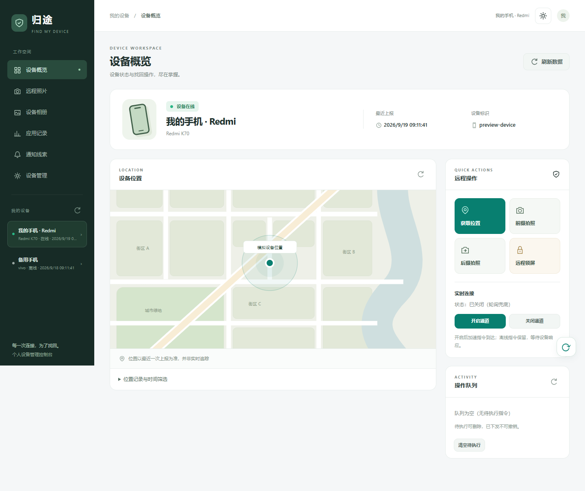
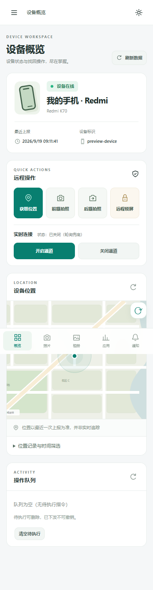
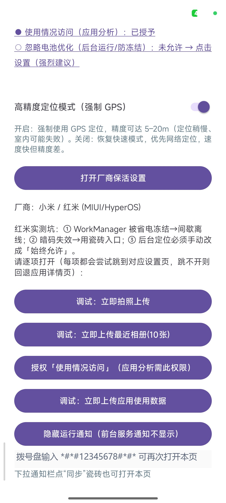

# AntiTheft Recover · 设备反连型防盗找回系统

手机丢失后，通过云端远程定位、取回照片与使用记录。

**核心设计是"反向连接"**——设备主动向云中继建立 WebSocket 并反向下行指令，从而在家庭宽带无公网 IP、路由器不支持端口映射的条件下依然可控。

已在 vivo（OriginOS）与红米（HyperOS/MIUI）双真机长期运行。

## 效果演示

**① Web 控制台 · 设备概览**

控制端是这套系统的"大脑"：左侧工作空间导航，右侧一屏内看全设备状态、地图位置、远程指令与操作队列。支持七种指令（获取位置 / 拍摄照片 / 后备快照 / 远程锁屏 / 实时连接开关），右侧「实时连接」面板可查看 WebSocket 是否在线 —— 这是双通道设计的可视化入口。



<table>
<tr>
<td align="center" valign="top"><br /><b>② 响应式布局 · 移动端窄屏</b><br /><sub>390px 宽度下自动折叠为单栏，Web 端与手机浏览器都能直接用</sub></td>
<td align="center" valign="top"><br /><b>③ 手机端设置页 · 厂商保活引导</b><br /><sub>App 唯一界面（桌面无图标）；下半部分是 ManufacturerCompat 的实际输出</sub></td>
</tr>
</table>

图里"红米实测坑"那三条（WorkManager 被省电冻结 → 间歇离线、暗码失效 → 改用瓷砖入口、后台定位必须手动改成「始终允许」）就是这套兼容层要解决的核心问题：**指令收不到，往往不是代码有问题，而是被 ROM 的后台策略杀掉了。**

## 功能一览

### 找回能力：手机丢了能拿回什么

| 功能 | 实现 | 有什么用 |
|---|---|---|
| **远程定位** | 腾讯定位 SDK 融合定位 + 高德逆地理 | 拿到经纬度并转成可读地址（"XX路XX小区"），人工能直接判断位置对不对 |
| **位置轨迹** | 轨迹落库 + `/locations` 查询 | 不只知"现在在哪"，还能看出"刚才去过哪"，推断移动方向 |
| **远程抓拍** | `CameraCapture`（Camera2 无预览抓拍前摄） | 指令触发后用前摄拍一张当前画面 —— 有没有人在用这台手机 |
| **远程拍照** | `CamShootActivity`（透明 Activity 瞬时上前台） | 与抓拍不同：允许用户手机弹出快门，用于补拍当前看不到的画面 |
| **相册同步** | `AlbumCollector` 读取系统媒体库缩略图 | 把手机里的照片回传到网页端；**手动触发，不静默读取** |
| **相册原图** | `/album/original` | 缩略图看不清时再拉原图，避免每次都传大文件 |
| **相册时间筛选** | 基线水位重置 + 时间窗筛选 | 只同步"上次同步之后新增/修改"的，避免重复上传；还能按时间段精准取回 |
| **相册批量操作** | 单选/全选/批量删/批量导出 | 找回来之后能直接整理，不用一张张点 |
| **使用轨迹** | `UsageStatsManager` 事件采集 | 不止"设备在哪"，还能还原"这个人用过哪些 App、打开过什么" |
| **通知内容** | `NotifyListenerService` 捕获通知栏文本 | 微信/QQ 等的聊天预览能拿到 —— 往往能直接看出失联前的最后对话 |
| **通知白名单** | 服务端只接受微信/QQ/短信 | 防御性设计：即使旧版 App 上报全量通知，也只落库这三家 |

### 控制能力：能对手机做什么

| 指令 | 实现 | 有什么用 |
|---|---|---|
| `activate` | 按需拉起前台服务（伪装通知渠道） | 唤醒 App 进入工作状态，平时完全休眠 |
| `locate` | `LocationReporter` 主动定位上报 | 立刻拿一次当前位置 |
| `photo` | `CameraCapture` | 远程抓拍当前画面 |
| `album` | `AlbumCollector` | 同步相册缩略图 |
| `album_original` | 原图拉取 | 取回指定照片的原始文件 |
| `usage` | `UsageCollector` | 采集并上传使用统计 |
| `lock` | `AntiTheftDeviceAdmin.lockNow()` | 远程锁屏 —— 捡到的人无法解锁 |
| `wipe` | `AntiTheftDeviceAdmin.wipeData()` | 远程清除数据 —— 涉及他人隐私，**仅在设备已授权 Device Admin 且你自己持有控制 Token 时可用** |
| `stop` | 停止当前服务 | 停止一切采集 |

> **权限边界说明**：`wipe` 与 `lock` 依赖设备管理员权限，必须由用户在手机上手动授权后才能使用；App **无法静默获取**该权限。控制端所有危险操作都强制校验 `CTRL_TOKEN`，且该 Token **不存在于 APK 中** —— 拿到手机的人也拿不到这个能力。

### 连接与保活：保证指令真的能到

| 功能 | 实现 | 有什么用 |
|---|---|---|
| **反向连接** | 设备端主动向云中继建 WebSocket | 家庭宽带无公网 IP、路由器不支持端口映射时依然可控 —— 这是整个系统能工作的前提 |
| **双通道同语义** | 15min `PollWorker` 轮询 + `RealtimeService` 实时通道，共用同一 `CommandDispatcher` | 实时通道断了还有轮询兜底；且两条通道执行语义完全一致，不会出现"实时能做的轮询做不了" |
| **指数退避重连** | 网络抖动时不硬重连 | 避免弱网环境下疯狂重连耗电、加重服务端压力 |
| **常驻守护** | `KeepAliveService` | 防丢连接的最后一道保险 |
| **充电复活** | `ChargeResumeWorker` + `PowerConnectedReceiver` | 插上充电器立刻拉起服务 —— 用户回家插电的那一刻，正好是设备恢复在线的时机 |
| **开机自启** | `BootReceiver` | 手机重启后自动恢复轮询（仅已注册设备才真正拉指令） |
| **电池优化检测** | `BatteryUtil` | 判断是否已被加入 Doze 白名单，未加入则明确提示用户去设置 |
| **厂商兼容层** | `ManufacturerCompat` 运行时识别品牌 | 输出差异化的保活引导与多个跳转 Intent，Intent 失败统一回退应用详情页 |
| **快捷设置瓷砖** | `AntiTheftTileService` | 下拉通知栏的开关入口 —— 部分 ROM 不向第三方派发暗码广播，磁贴是兼容性最好的入口 |

### 无感运行：不让用户发现

| 功能 | 实现 | 有什么用 |
|---|---|---|
| **默认静默休眠** | App 平时不启任何服务 | 不打扰用户，日常几乎不耗电 |
| **通知伪装** | `IMPORTANCE_MIN` 渠道 + `VISIBILITY_SECRET` | 前台服务必须显示通知，但可做到不弹横幅、不响、不亮屏 |
| **无桌面图标** | 不注册 LAUNCHER intent | 桌面找不到入口 |
| **唯一 UI 是设置页** | `SettingsActivity` | 只能通过暗码、磁贴或 adb 打开 |
| **设备凭证加密存储** | `Prefs`（加密 SharedPreferences） | 设备 token 不落明文 |

### 服务端能力：控制台与数据管理

| 功能 | 端点 | 有什么用 |
|---|---|---|
| **设备注册** | `POST /anti-theft/register` | 手机首次启动时注册，获得设备级随机 token（不含控制权限） |
| **指令队列** | `GET /commands` · `POST /command` · `DELETE /command/{id}` | 下发、查询、撤销指令；删除单条是"发错了撤回" |
| **实时通道** | `WS /ws/anti-theft` | 服务端命令秒级 push，且可一次多条 |
| **设备列表** | `GET /devices` | 所有已注册设备的在线状态与最后上报时间 |
| **审计日志** | `GET /audit-log` | 谁在什么时候下了什么指令，全量留痕 |
| **状态查询** | `GET /status` | 中继服务自身状态 |
| **数据清理** | `POST /cleanup` + `GET /cleanup-preview` | 批量清理照片/相册/通知数据；**先预览影响范围再执行** |
| **通知管理** | `GET /notify` · `/notify-data` · `/notify-summary` · `POST /notify-read` · `/notify-delete` | 查看、统计、标记已读、删除通知 |

## 核心能力

| 能力 | 实现方式 | 解决的问题 |
|---|---|---|
| 远程指令下发 | WebSocket 反向连接 + 指数退避重连 | 云在公网、设备在内网的可达性倒置 |
| 双通道保底 | 15min WorkManager 轮询 + 实时 WS，共用同一 CommandDispatcher | 实时通道断开也不漏指令，且两条通道执行语义完全一致 |
| 无感运行 | 默认静默休眠，Web 端下发指令唤醒 | 不打扰用户，App 平时几乎不耗电 |
| 位置追踪 | 高德逆地理编码 + 轨迹落库 | 原始经纬度转可读地址，可人工判断 |
| 使用轨迹 | UsageStatsManager 事件采集 | 不止"设备在哪"，还能还原"人用过什么、去过哪" |
| 相册找回 | 基线水位重置 + 时间窗筛选 + 1024px 缩略图压缩 | 避免重复上传、按时间范围精准取回 |
| 厂商兼容 | `ManufacturerCompat` 运行时识别品牌输出差异化保活引导 | MIUI/HyperOS/OriginOS 的保活策略各不相同 |

## 架构

```
┌──────────────── Android 客户端 (Kotlin, 25 模块) ────────────────┐
│  SecretCodeReceiver ──▶ SettingsActivity                         │
│  CommandDispatcher ◀── PollWorker(15min) ┐                       │
│                    ◀── RealtimeService(WS)┘                      │
│  AntiTheftService / LocationReporter / UsageCollector            │
│  AlbumCollector / CameraCapture / NotifyListenerService         │
│  ManufacturerCompat（厂商 ROM 兼容层）                            │
└───────────────────────────────┬─────────────────────────────────┘
                                │ WebSocket 反向连接（设备主动建连）
                                ▼
┌──────────────── 云端中继 (FastAPI, 3500+ 行) ──────────────────┐
│  /anti-theft/*  设备注册 · 指令队列 · 位置上报 · 相册检索 · 审计  │
│  /ws/anti-theft  实时通道                                       │
│  鉴权：CTRL_TOKEN 环境变量（未配置则拒绝所有控制端读写）        │
└───────────────────────────────┬─────────────────────────────────┘
                                ▼
                        Web 控制台（浏览器）
```

## 指令集

`activate` · `locate` · `photo` · `album` · `album_original` · `usage` · `lock` · `wipe` · `stop` · `realtime`

轮询与实时通道共用同一份 `CommandDispatcher`，保证无论指令从哪条通道到达，客户端执行语义完全一致。

## 工程设计要点

- **双通道同语义**：15 分钟 WorkManager 轮询作为兜底，WebSocket 作为实时通道，两者共享 `CommandDispatcher`，避免"两套逻辑各自演化"的经典坑。
- **ROM 兼容工程化**：`ManufacturerCompat` 把红米/HyperOS 的实测坑位（暗码不广播 `SECRET_CODE`、`WorkManager` 被省电冻结、后台定位需手动改「始终允许」）固化为带跳转 Intent 的引导步骤，Intent 失败统一回退应用详情页。
- **安全默认拒绝**：控制端鉴权 Token 从环境变量读取，未配置时**所有读写接口直接拒绝**，而不是放行；高德 Key 只存在服务端，绝不下发到手机端。
- **数据隔离**：每个设备独立数据域，账号间按 SHA256 哈希物理分库。
- **审计留痕**：命令下发与操作全量记录审计日志。

## 目录结构

```
app/                      Android 客户端
  app/src/main/java/com/example/antitheft/
    CommandDispatcher.kt      指令分发（双通道共用）
    RealtimeService.kt        WebSocket 实时通道
    PollWorker.kt             15min 轮询兜底
    AntiTheftService.kt       核心服务
    LocationReporter.kt       定位上报
    UsageCollector.kt         使用事件采集
    AlbumCollector.kt         相册同步
    ManufacturerCompat.kt     厂商 ROM 兼容层
    ...
server/                   云端中继
  anti_theft.py              FastAPI 路由（20+ 端点）
  main.py                    独立部署入口
```

## 快速开始（他人 clone 后如何部署成自己的系统）

> **本项目必须搭配一台云服务器运行中继服务**，手机才能被远程控制。
> 仓库中**不提供任何预置 APK** —— 因为 APK 内置了中继地址，别人直接安装会连到我的服务器。
> 正确做法是：clone → 改配置 → 自己构建 APK → 部署自己的中继。
>
> 整体流程：
>
> ```
> ① 服务器：装中继服务 → 配密钥 → Nginx 反代 HTTPS/WSS
>                              ↑
> ② 手机：改 RELAY_BASE 与暗码 → 构建 APK → 安装 → 授予权限与保活
>                              ↓
> ③ 浏览器：打开控制台 → 输入 CTRL_TOKEN → 下发指令
> ```

### 0. 需要改哪些配置（总览）

| 配置项 | 在哪里改 | 是否必填 | 说明 |
|---|---|---|---|
| `RELAY_BASE` | `app/app/src/main/java/.../Constants.kt` | **必填** | 你的中继服务器地址，客户端所有请求都以它为前缀 |
| `SECRET_CODE` | `Constants.kt` **和** `AndroidManifest.xml` | **必填** | 拨号暗码，两处必须一致 |
| `TencentMapKey` | `app/local.properties` | **必填** | 腾讯定位 SDK Key（逆地理与定位） |
| `CTRL_TOKEN` | 服务端环境变量 | **必填** | 控制端鉴权 Token，未配置则服务端拒绝所有控制请求 |
| `AMAP_WEB_KEY` | 服务端环境变量 | 可选 | 高德 **Web 服务** Key（服务端 REST 调用，逆地理用），不配则回退 Nominatim（较慢） |
| `AMAP_JS_KEY` | 服务端环境变量 | 可选 | 高德 **Web 端(JS API)** Key（控制台网页加载地图用），不配则地图底图不显示 |
| `AMAP_JS_CODE` | 服务端环境变量 | 可选 | 上面那个 JS Key 配套的**安全密钥 securityJsCode**（2021-12-02 后创建的 Key 必须配，否则地图接口报 `INVALID_USER_SCODE`） |

> **三个高德 Key 别搞混**：本项目用到了高德的两类 Key，**它们是独立申请的两套凭证**。
>
> | Key 类型 | 控制台里的平台 | 用在哪 | 安全限制 |
> |---|---|---|---|
> | Web 服务 Key | 服务平台选「Web服务」 | `restapi.amap.com/v3/geocode/regeo` 逆地理（服务端发起） | **IP 白名单**（填服务器公网 IP），不用域名白名单 |
> | Web 端 JS Key | 服务平台选「Web端(JS API)」 | `webapi.amap.com/maps?v=2.0` 加载地图（浏览器发起） | **域名白名单**（填站点域名）+ 安全密钥 |
>
> 泄露风险也不同：Web 服务 Key 只在服务端用，配了 IP 白名单别人就调不动；JS Key 天生暴露在前端 HTML 里，靠**域名白名单**防盗用。

> 📖 **完整申请与配置步骤见 [`server/高德Key与白名单配置指南.md`](server/高德Key与白名单配置指南.md)** —— 含域名白名单的格式踩坑点、安全密钥的作用、Nginx 代理转发方案、以及一份「泄露了怎么办」的应急流程。

---

### 第一部分：部署你自己的中继服务器

#### 1.1 准备服务器

- 一台有公网 IP 的 Linux 服务器（**1 核 1G 足够**，本项目不吃资源）
- 一个域名（如 `relay.yourdomain.com`），把 A 记录解析到服务器 IP
- 开放 **80 / 443** 端口（80 用于 certbot 申请证书，443 提供服务）

```bash
# 验证域名解析生效
ping -c 1 relay.yourdomain.com
# 期望看到你服务器的 IP
```

#### 1.2 上传并安装服务端

```bash
# 把仓库里的 server/ 目录传到服务器，例如 /www/wwwroot/antitheft-relay/
cd /www/wwwroot/antitheft-relay

# 创建虚拟环境
python3 -m venv venv
source venv/bin/activate
pip install -r requirements.txt
```

> `requirements.txt` 在 `server/` 目录里。如果只传了部分文件，记得把它一起传上去，
> 或者手动装：`pip install fastapi uvicorn pydantic python-multipart aiofiles requests`。

#### 1.3 配置密钥（关键）

```bash
# 控制端鉴权 Token —— 必须配置，否则所有控制接口直接拒绝
export CTRL_TOKEN=$(openssl rand -hex 32)

# 高德 Key（两套，独立申请，详见上面的对照表）
#   Web 服务 Key —— 服务端逆地理用，配 IP 白名单
export AMAP_WEB_KEY=你的高德Web服务Key
#   Web 端 JS Key + 安全密钥 —— 控制台网页加载地图用，配域名白名单
export AMAP_JS_KEY=你的高德JS端Key
export AMAP_JS_CODE=你的高德安全密钥

# 把 token 记下来 —— 第三部分打开控制台时需要输入它
echo "你的控制端 Token 是：$CTRL_TOKEN"
```

> 也可以把 Token 写进项目根目录的 `.ctrl_token` 文件（首行）。优先级：**环境变量 > `.ctrl_token` 文件**。
> **两者都不配置时，服务端会拒绝所有控制端读写接口**（安全默认），这是刻意设计 —— 没有鉴权的公网接口等于把手机交出去。

#### 1.4 启动服务

先手动跑一次，确认没报错：

```bash
cd /www/wwwroot/antitheft-relay
source venv/bin/activate
export CTRL_TOKEN=你的token
uvicorn main:app --host 127.0.0.1 --port 8001 --workers 1
```

> **必须 `--workers 1`**：本服务用 SQLite 存数据，多进程并发写会导致锁冲突。

看到类似 `Uvicorn running on http://127.0.0.1:8001` 就说明起来了。**Ctrl+C 停掉**，然后交给 supervisor 托管：

用 supervisor 保持常驻（`/etc/supervisor/conf.d/antitheft.conf`）：

```ini
[program:antitheft]
directory=/www/wwwroot/antitheft-relay
command=/www/wwwroot/antitheft-relay/venv/bin/uvicorn main:app --host 127.0.0.1 --port 8001 --workers 1
autostart=true
autorestart=true
environment=CTRL_TOKEN="你的token",AMAP_WEB_KEY="你的webservicekey",AMAP_JS_KEY="你的jskey",AMAP_JS_CODE="你的安全密钥"
```

```bash
supervisorctl reread && supervisorctl update && supervisorctl status antitheft
# 期望看到 antitheft    RUNNING
```

#### 1.5 配置 Nginx 反代（提供 HTTPS/WSS）

```nginx
server {
    listen 443 ssl http2;
    server_name relay.yourdomain.com;

    ssl_certificate     /www/wwwroot/cert/fullchain.pem;
    ssl_certificate_key /www/wwwroot/cert/privkey.pem;

    location / {
        proxy_pass http://127.0.0.1:8001;
        proxy_http_version 1.1;

        # WebSocket 升级（实时通道必需）
        proxy_set_header Upgrade $http_upgrade;
        proxy_set_header Connection "upgrade";
        proxy_set_header Host $host;
        proxy_set_header X-Real-IP $remote_addr;
        proxy_set_header X-Forwarded-For $proxy_add_x_forwarded_for;
        proxy_set_header X-Forwarded-Proto $scheme;

        # 实时通道是长连接，务必关掉超时
        proxy_read_timeout 3600s;
        proxy_send_timeout 3600s;
    }
}
```

证书用 certbot 申请：

```bash
certbot --nginx -d relay.yourdomain.com
nginx -s reload
```

> **为什么必须 HTTPS/WSS**：手机端把 `RELAY_BASE` 里的 `https://` 自动换成 `wss://` 建立实时长连接，明文 HTTP 下 WebSocket 会被浏览器/系统策略拦截，且控制指令与定位数据明文传输存在泄露风险。

**验证中继起来了**：

```bash
curl https://relay.yourdomain.com/anti-theft/status
# 期望返回 JSON
```

---

### 第二部分：修改客户端配置并构建

#### 2.1 克隆

```bash
git clone https://github.com/NanYi-A/antitheft-recover.git
cd antitheft-recover
```

#### 2.2 改中继地址（最重要的一步）

编辑 `app/app/src/main/java/com/example/antitheft/Constants.kt`：

```kotlin
object C {
    /** 云中继基址（HTTPS，标准 443 端口，经 Nginx 反代到本地 8001）。
     *  WS 地址由 RealtimeService 自动派生为 wss://（见 RealtimeService.kt）。 */
    const val RELAY_BASE = "https://relay.yourdomain.com"   // ← 改成你自己的

    /** 暗码：拨号盘输入 *#*#<你的数字>#*#* 唤起设置页 */
    const val SECRET_CODE = "87654321"                      // ← 改成你自己的
}
```

> **地址格式要求**：必须带 `https://`，**末尾不要加斜杠或路径**（结尾是域名就停）。
> 客户端**所有**接口都基于 `RELAY_BASE` 拼接（`RelayApi.kt` 里的 `/anti-theft/register`、`/poll`、`/report`、`/album`…，以及 `RealtimeService.kt` 的 `/ws/anti-theft`），所以**改这一处就够了**，不需要动任何其他文件。

#### 2.3 同步修改暗码（Manifest）

暗码在 `Constants.kt` 和 `AndroidManifest.xml` **各有一份**，必须一致，否则广播收不到：

`app/app/src/main/AndroidManifest.xml`：

```xml
<!-- 暗码唤起：拨号盘输入 *#*#87654321#*#* 打开设置页 -->
<receiver
    android:name=".SecretCodeReceiver"
    android:exported="true">
    <intent-filter>
        <action android:name="android.provider.Telephony.SECRET_CODE" />
        <data android:scheme="android_secret_code" android:host="87654321" />
    </intent-filter>
</receiver>
```

> 暗码只能是数字，且**同一台手机上唯一**（这是 Android 系统限制）。
> 改的时候记得两处一起改（`android:host` 也要改）。

#### 2.4 配置腾讯定位 Key

`app/local.properties`：

```properties
sdk.dir=/path/to/your/Android/sdk
TencentMapKey=你的腾讯定位Key
```

> ⚠️ **Windows 用户注意**：`local.properties` 是 Java properties 格式，路径里的反斜杠是转义字符。
> 写成 `sdk.dir=C:\Users\you\AppData\Local\Android\sdk` 会报
> `IOException: 文件名、目录名或卷标语法不正确`。
> **推荐直接用正斜杠**：`sdk.dir=C:/Users/you/AppData/Local/Android/sdk`。

到 <https://lbs.qq.com/> 申请 Key，勾选「WebServiceAPI」，授权 PackageName 填 `com.example.antitheft`。
`build.gradle.kts` 会自动把它注入到 Manifest 的 `${TENCENT_MAP_KEY}` 占位符。

#### 2.5 构建

```bash
cd app

# 先跑一遍看是否正常
./gradlew assembleDebug

# 或构建体积更小的 release 版
./gradlew assembleRelease
```

产物：`app/app/build/outputs/apk/debug/app-debug.apk`

> 签名：release 配置使用 Android 自带的 debug keystore（首次构建自动生成），因此 **clone 后无需任何私钥即可构建出能直接安装的 APK**。正式发布请自行创建 keystore 并替换 `signingConfigs`。

#### 2.6 安装与激活

```bash
adb install -r app/app/build/outputs/apk/debug/app-debug.apk
```

安装后 App **没有桌面图标**（这是刻意设计，避免被察觉）。三种激活方式：

| 方式 | 怎么做 | 说明 |
|---|---|---|
| **A（推荐）** | 下拉通知栏找到名为「**同步**」的磁贴，点一下 | 跨厂商通用。部分 ROM 不向第三方 App 派发暗码广播，所以磁贴入口兼容性最好 |
| **B** | 拨号盘输入 `*#*#87654321#*#*` | 就是你在 2.3 步设的暗码 |
| **C** | `adb shell am start -n com.example.antitheft/.SettingsActivity` | 调试用，不用拨号盘 |

进入设置页后填入中继地址（就是 `RELAY_BASE` 的值），App 会在首次运行时**自动注册设备**并取得设备级 token。

#### 2.7 授予权限与保活

首次启动后按提示授予：**位置**（要选「始终允许」，不是「仅在使用中允许」）、**相册**、**通知**、**使用情况访问**。

**厂商保活是这套系统能否工作的关键** —— 不同 ROM 会用各种方式杀掉后台服务。App 内置了 `ManufacturerCompat` 兼容层，运行时会识别你的品牌并给出**带一键跳转的引导页**，按提示逐项打开即可：

| 品牌 | 必做项 |
|---|---|
| 小米 / 红米（MIUI/HyperOS） | ① 允许自启动 ② 电池优化设为「无限制」③ 允许后台弹出界面 ④ 后台定位权限改为「始终允许」 |
| vivo（OriginOS/Funtouch） | ① 允许自启动 ② 电池优化设为「无限制」③ 允许高后台权限 |
| 华为 / 荣耀 | ① 应用启动管理中设为手动 ② 允许自启动 ③ 电池优化白名单 |
| OPPO / 一加 / realme | ① 允许自启动 ② 允许后台运行 ③ 电池优化白名单 |

> 这些不是"设置 App"本身的功能，而是**让长连接能持续存活**的必要条件 —— 指令下发与定位上报全靠这条连接。
> 漏了任何一项，表现为"偶尔连不上"或"过一会儿就离线"。

**怎么确认保活成功**：在设置页看实时连接状态，应该是「已连接」。或者从电脑端看：

```bash
curl https://relay.yourdomain.com/anti-theft/status
# 期望在返回的 devices 里看到你的设备，且在线
```

#### 2.8 打开 Web 控制台

浏览器访问 `https://relay.yourdomain.com/`，输入你在 1.3 步设置的 `CTRL_TOKEN`，即可看到设备列表、地图位置、相册缩略图与指令按钮。

---

### 常见问题

| 现象 | 原因与解决 |
|---|---|
| App 一直显示离线 | ① 检查中继服务是否在跑；② 检查 Nginx 反代与证书；③ 检查 `RELAY_BASE` 是否写对；④ 检查厂商保活设置 |
| 拨号盘输暗码没反应 | ① 确认 `Constants.kt` 与 `AndroidManifest.xml` 两处数字一致；② 部分 ROM 不派发暗码广播，改用通知栏磁贴 |
| 定位一直是空的 | ① 没授予后台定位"始终允许"；② 没配 `TencentMapKey`；③ 室内无 GPS 时需用 WiFi/基站定位 |
| 提示"token 无效" | 服务端 `CTRL_TOKEN` 未配置或客户端 token 与服务端不一致；检查 supervisor 的 environment 配置 |
| 相册同步为空 | ① 未授予相册权限（Android 13+ 需 `READ_MEDIA_IMAGES`）；② 需先发过一次 `album` 指令建立基线 |
| 上传大图失败 | 服务端限制了图片尺寸，客户端已自动压到 1024px；确认 Nginx 的 `client_max_body_size` 不小于 20M |
| 构建报 `IOException: 文件名、目录名或卷标语法不正确` | `app/local.properties` 里的 `sdk.dir` 反斜杠没转义。Java properties 格式要求写成 `C:\\Users\\you\\...`，或直接用正斜杠 `C:/Users/you/...` |
| 构建报"路径含非 ASCII 字符" | Windows 下 Gradle 限制，把仓库克隆到纯英文路径，或在 `app/gradle.properties` 加 `android.overridePathCheck=true` |

## 安全设计

### 已做的只读安全审计

`server/安全审计报告.md` 是一份针对本项目的**只读源码安全审计报告**，聚焦三条攻击链：

| 攻击链 | 结论 |
|---|---|
| 未授权获取后台管理员权限 | ✅ 不存在绕过鉴权的路径 —— 所有危险操作（下发 `wipe`/`lock`、删除设备、删除照片、读取位置/通知）全部强制 `Depends(ctrl_auth)` |
| 远程执行 wipe | ✅ 安卓 APK **不含** `CTRL_TOKEN`，客户端只持有注册时下发的设备级随机 token（`secrets.token_hex(32)`）；小偷拿到手机无法提取后台管理员 token |
| 信息泄露 | ✅ 全部 SQL 参数化查询，无拼接注入；设备数据域物理隔离 |

**结论一句话**：防 `CTRL_TOKEN` 泄露 = 防 `wipe`，而 APK 里根本没有这个 Token。

> 这份报告也是本项目在设计上把"危险操作必须二次鉴权"落到代码里的原因 —— 不是事后补的，是设计时就有的。

### 关键安全机制

| 机制 | 实现 |
|---|---|
| 控制端鉴权 | `CTRL_TOKEN` 走环境变量 / `.ctrl_token` 文件，**未配置则所有控制端接口直接拒绝**（安全默认） |
| 设备级令牌 | 客户端只持有注册时下发的随机 token，无后台管理权限 |
| 服务端密钥隔离 | 高德 Key 只存在服务端，绝不下发到手机端 |
| 数据隔离 | 每设备独立数据域；账号间按 SHA256 哈希物理分库 |
| 审计留痕 | 命令下发与操作全量记录审计日志 |

## 安全说明

本仓库为**公开演示版本**，已做以下脱敏处理：

| 项目 | 仓库中的值 | 使用时需改为 |
|---|---|---|
| 中继地址 | `relay.example.com` | 你自己的域名（`Constants.kt` 的 `RELAY_BASE`） |
| 拨号暗码 | `12345678` | 你自己的数字（`Constants.kt` + `AndroidManifest.xml` 两处） |
| 腾讯地图 Key | 占位符，走 `local.properties` 的 `TencentMapKey` | 你自己申请的 Key |
| 服务端 `CTRL_TOKEN` | 无默认值 | 用 `openssl rand -hex 32` 生成 |
| 服务端 `AMAP_WEB_KEY` | 无默认值 | 你自己申请的高德 Web 服务 Key（可选） |

**服务端密钥全部走环境变量，仓库内无任何真实凭据。**

⚠️ **关于本仓库不提供 APK**：APK 内置了中继地址与设备身份，直接分发会让他人连接到作者的中继服务器，既可能造成隐私泄露，也会让服务器被他人滥用。因此请按上文"快速开始"自行修改配置并构建。

**部署到自己的服务器前请务必**：
1. 修改 `Constants.kt` 中的 `RELAY_BASE` 与 `SECRET_CODE`
2. 同步修改 `AndroidManifest.xml` 中的暗码 host（两处必须一致）
3. 在 `app/local.properties` 配置 `TencentMapKey`
4. 为服务端设置强随机的 `CTRL_TOKEN`
5. 确认 Nginx 的 `client_max_body_size` 不小于 20M（否则大图上传会 413）

## 致谢

- [Android WorkManager](https://developer.android.com/topic/libraries/architecture/workmanager) — 后台周期任务
- [FastAPI](https://fastapi.tiangolo.com/) — 云端中继服务

## 许可证

MIT License
